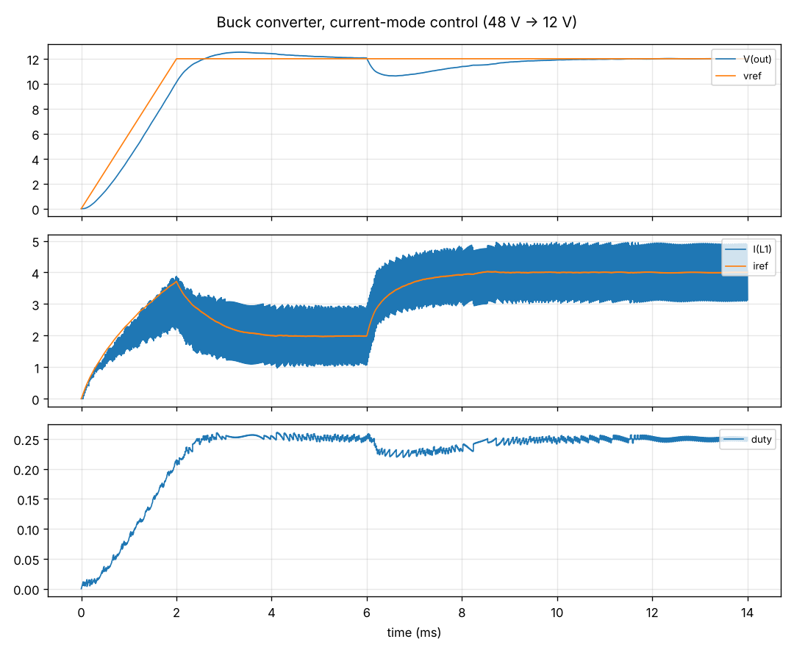
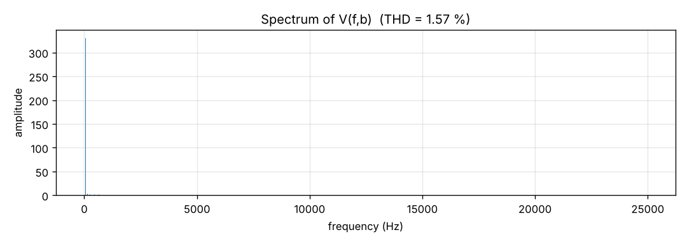
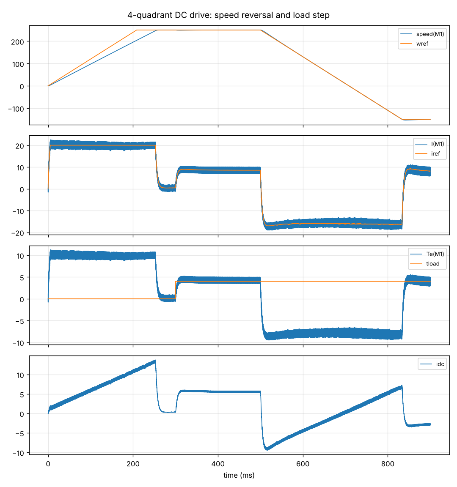
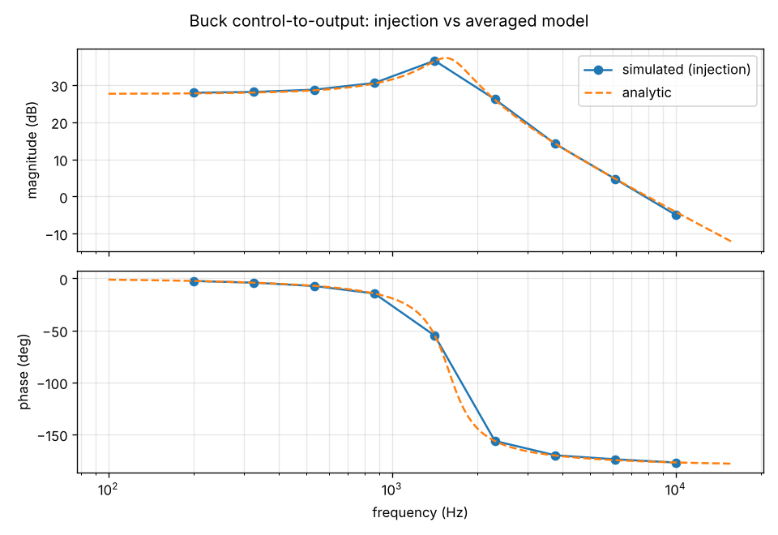

# OpenPE — open-source power-electronics simulator

OpenPE is a Python circuit simulator for **power electronics, motor drives
and their control loops**.  It collects the features that make dedicated
power-electronics simulators such as PSIM pleasant to use:

* ideal switch models and a fast fixed time step
* a power circuit kept separate from the control circuit, linked by sensors
* ready-made PWM, PI and dead-time blocks
* motor-drive elements
* a waveform viewer with FFT/THD
* parameter sweeps and AC sweeps on the switching circuit itself

It's pure Python: only `numpy` is required, and `matplotlib` is optional
for plots.

```python
import openpe as pe

c = pe.Circuit("Buck 48 V -> 12 V")
c.V("Vin", "in", "0", 48)
c.S("Q1", "in", "sw", gate="g")        # ideal switch driven by signal "g"
c.D("D1", "0", "sw")
c.L("L1", "sw", "out", 100e-6)
c.C("C1", "out", "0", 220e-6)
c.R("RL", "out", "0", 6)
c.add(pe.Constant("d", 0.25), pe.PWM("g", "d", freq=50e3))

res = c.simulate(dt=0.21e-6, t_end=10e-3)
print(res.last(1e-3).mean("V(out)"))   # -> 11.99
res.plot("V(out)", ["I(L1)", "I(D1)"], save="buck.png")
```

---

## Feature overview

| PSIM-style feature | OpenPE implementation |
|---|---|
| **Ideal switch models** | `Switch` (MOSFET/IGBT, optional body diode), `Diode` (optional Vf), `Thyristor` (latching SCR). Piecewise-linear on/off resistances, with automatic diode/thyristor state iteration. |
| **Fast fixed-step solver** | MNA with trapezoidal (default) or backward-Euler companion models. Each switch-state combination's matrix is inverted **once and cached**, so a converter that cycles through a few topologies costs one matrix-vector product per step. |
| **Clean switching transients** | When the topology changes, that step is recomputed with backward Euler. This suppresses the trapezoidal rule's numerical ringing. Steps with no consistent switch state (zero crossing inside the step) are resolved automatically. |
| **Separate power and control circuits** | Control blocks run once per step after the power solve (one-step delay, as in PSIM). Algebraic loops are detected and reported. |
| **Sensors** | `VoltageSensor`, `CurrentSensor`, `ProbeSensor` (any quantity, e.g. `speed(M1)`). Signal-controlled sources (`V(..., signal="x")`) take control signals back into the power circuit. |
| **Control library** | Constant, sine, triangle/sawtooth carriers, square, step, ramp, gain, sum, product, divide, abs, limiter, rate limiter, comparator (with hysteresis), logic gates, **PWM**, **dead time**, integrator, **PI / PID** with anti-windup, **transfer function** (Tustin), low-pass, unit delay, moving average, RMS meter, abc↔dq transforms, PLL. |
| **C block** | `PythonBlock(outputs, inputs, fn, state)` runs arbitrary user code with persistent state, for example a complete digital controller. `Function` covers simple algebraic expressions. |
| **Digital control** | `SampleHold` (ZOH/ADC sampling, synchronous sampling), unit delay, computation-delay modelling inside a `PythonBlock`. |
| **Magnetics** | `IdealTransformer`, `Transformer` (magnetising + leakage inductance, winding resistance), `CoupledInductors` (any coupling k). |
| **Motor drive module** | `DCMotor`, fully electro-mechanical (current *and* speed are solver unknowns). Load torque can be a constant, a function `f(t, w)` or a control signal. Probes: `I`, `speed`, `rpm`, `Te`. |
| **Sources** | DC, sine, square, step, piecewise-linear, any `f(t)`, balanced `ThreePhaseSource`, current sources. |
| **SIMVIEW-like post-processing** | `mean`, `rms`, `min/max`, `ripple`, `fft`, `harmonic`, `thd`, `power` per element, `efficiency`, `power_factor`, differential voltages `V(a,b)`, time windows, multi-panel plots, spectrum plots, CSV export. |
| **Parameter sweep** | `parameter_sweep(build, {"L": [...], "fsw": [...]}, ...)`: Cartesian sweeps, optional multiprocessing, table output. |
| **AC sweep** | `ac_sweep(...)`: frequency response by **small-signal injection into the switching circuit**, so no averaged model is needed. `plot_bode`, `tf_response` for comparison. |
| **Netlist + CLI** | SPICE-like text netlists with control blocks, `.param`, `.tran`, `.plot`, `.measure`, `.window`. `python -m openpe run file.net --plot out.png --csv out.csv`. |
| **Subcircuits** | `Circuit.subcircuit(prefix, other, port_map)` reuses any circuit as a block. |

---

## Installation

```bash
pip install -e ".[dev]"     # numpy + matplotlib + pytest
pytest -q                   # 45 tests, ~10 s
```

## Examples

Every script in `examples/` is self-contained and writes plots to
`examples/output/`.

| Script | What it demonstrates | Key results |
|---|---|---|
| `01_buck_closed_loop.py` | Buck with cascaded voltage/current PI loops, soft start, load step, synchronous current sampling | 12.00 V regulated through a 2→4 A load step |
| `02_inverter_spwm_thd.py` | Full-bridge inverter, unipolar SPWM, 1 µs dead time, LC filter, FFT/THD | Output THD 1.6 % (bridge voltage 57 %) |
| `03_thyristor_rectifier_sweep.py` | 6-pulse SCR rectifier with source inductance, firing-angle sweep | Vdc matches `1.35·VLL·cosα − 3ωLsId/π` within 0.1 % |
| `04_dc_motor_drive.py` | 4-quadrant H-bridge DC drive, speed + current loops, load step, speed reversal with regeneration | Speed tracks the reference, current limit holds at 20 A |
| `05_ac_sweep_buck.py` | Control-to-output Bode plot of a *switching* buck by injection | Within ~0.2 dB / 1° of the averaged model |
| `06_flyback_rcd_clamp.py` | Flyback with leakage inductance, RCD clamp, Coss | Drain peak 94 V with clamp, 202 V without |
| `07_digital_control_cblock.py` | Boost converter controlled by microcontroller-style code in a `PythonBlock` (ADC ZOH, 1-sample delay) | 24 V regulated through a load step |
| `08_boost_pfc.py` | Single-phase boost PFC, average-current mode, multiplier reference, duty feed-forward | PF 0.989, line THD 3 % at 400 W |

Netlist examples are in `circuits/`:

```bash
python -m openpe run circuits/buck_current_mode.net --plot buck.png --summary
python -m openpe run circuits/three_phase_rectifier.net
python -m openpe blocks          # list control block types
```

<p align="center">




</p>

---

## Netlist format

```text
* comment
.param vin=48 fsw=50k
Vin   in  0   DC {vin}            ; V/I: DC v | SIN amp f [ph off] | SQUARE v1 v2 f [duty] | STEP t v0 v1 | SIGNAL sig [gain]
S1    in  sw  gate                ; switch: n1 n2 gate_signal [ron= roff= body_diode=1]
D1    0   sw                      ; diode: anode cathode [vf= ron= roff=]
Q1    a   k   g1                  ; thyristor
L1    sw  out 100u  ic=0
C1    out 0   220u  ic=0
T1    p1 p2 s1 s2 2 lm=200u llk=2u    ; transformer, n = Np/Ns
K1    a b c d 1m 4m 0.99              ; coupled inductors L1 L2 k
M1    a 0 ra=1 la=5m ke=0.5 j=0.01 tload=tl   ; DC motor
G1    a b c 0 400 50                  ; 3-phase source, VLL rms, f
* control blocks:  B<id> TYPE outputs... inputs... key=value
B1 VSENSOR  vo out 0
B2 ISENSOR  il L1
B3 SUM      err vref vo signs=+-
B4 PI       d err kp=0.05 ki=200 lo=0 hi=0.95
B5 PWM      gate d freq={fsw}
B6 TF       y u num=1 den=1e-3,1
.tran 0.2u 8m [method=trap|be] [start=t] [every=n]
.window 1m                         ; measurements over the last 1 ms
.plot V(out),vref I(L1)            ; comma = overlay in one panel
.measure mean V(out)               ; mean | rms | max | min | pp | thd sig f0 [cycles]
.end
```

## Conventions

* Ground is node `0` (aliases `gnd`, `GND`, `ground`).
* Element current `I(X)` flows from the element's first node to its second
  *through the element* (passive sign convention). `power(X) > 0` means
  absorbed, so a source delivering power reads negative.
* Recorded automatically: every node voltage `V(n)`, every element current,
  every control signal, plus element extras such as `speed(M1)` or `Is(T1)`.
  Differential voltages: `res["V(a,b)"]`. Voltage across an element:
  `res["VE(R1)"]`.

## How the solver works

1. Gated switches take their state from the control signals of the
   previous step.
2. The MNA system `A·x = b` is solved. `A` depends only on the switch
   states (and the integration method), so its inverse comes from a cache.
   Only `b` (sources and element history) is rebuilt every step.
3. Diodes and thyristors check their state against the solution and the
   step is repeated until the states are consistent. If the iteration
   cycles (a device current crosses zero inside the step), the
   least-violating state is accepted. Those steps are counted in
   `res.meta["stats"]["ambiguous_steps"]`.
4. If the topology changed, the step is redone with backward Euler (no
   trapezoidal ringing), and the first step always uses backward Euler.
5. Element histories are updated, sensors read and the control circuit is
   evaluated. Carrier-type blocks (triangle, sawtooth, square, PWM) are
   sampled at the middle of the interval they control, which removes the
   systematic duty-cycle bias of naive sampling.

`res.meta["stats"]` reports steps, matrix factorisations, damped steps and
CPU time.

## Accuracy notes and limitations

* **PWM resolution is `dt · fsw`**, as in any fixed-step simulator. Use at
  least 100–200 steps per switching period. If an exact duty cycle such as
  0.25 matters, avoid a step size that puts the switching edge exactly on
  a sample.
* Backward-Euler damping at switching instants adds a small numerical loss
  in reactive elements. It is proportional to `dt` and only visible in
  precise efficiency studies; use a smaller `dt` for those.
* Switches are ideal (no switching-loss or thermal models). Conduction
  loss comes from `ron`/`vf`.
* Only DC machines are included. AC machines can be built from the
  provided dq transforms, sources and `PythonBlock`.

## Project layout

```
openpe/
  elements.py    power-circuit elements (R, L, C, sources, switches, magnetics, DC motor)
  control.py     control blocks (sources, math, PWM, PI/PID, TF, ZOH, transforms, PLL, ...)
  circuit.py     Circuit container, palette shortcuts, subcircuits
  simulator.py   fixed-step MNA solver with matrix caching and switch-state iteration
  results.py     waveform analysis, plots, CSV
  analysis.py    parameter sweep, AC sweep, Bode helpers
  netlist.py     text netlist parser
  __main__.py    command-line interface
examples/        runnable showcase scripts (+ output/ plots)
circuits/        example netlists
tests/           pytest suite (analytic checks of every feature)
```

## License

MIT
